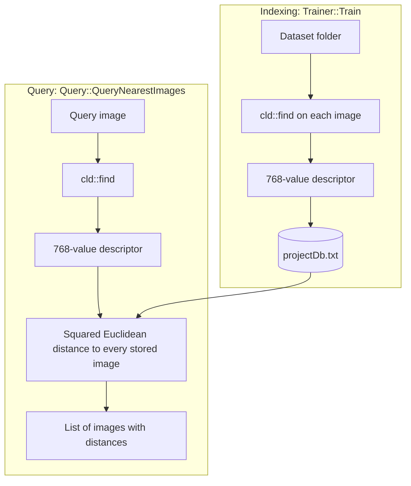

# CBIR Project

A **Content-Based Image Retrieval** engine written from scratch in C++. Give it an image and it finds the most visually similar images in a dataset by comparing their colors and where those colors sit in the picture. It does not use file names, tags, or machine learning.

The project has two parts:

- **The retrieval engine (working):** extracts a 768-number color descriptor from each image, stores the descriptors in a text file, and ranks images by distance to a query.
- **A wxWidgets desktop interface (in progress):** the window is laid out, but its buttons are not connected to the engine yet. See [Current status](#current-status).

## Results

Query: `628.jpg`, a yellow rose. The query is itself in the dataset, so it comes back first with a distance of 0.

| Rank | Saved as | Dataset image | Squared distance | Image |
|---|---|---|---:|---|
| 1 | `Results/M1.jpg` | `628.jpg` (the query) | 0 |  |
| 2 | `Results/M2.jpg` | `600.jpg` | 508,835 |  |
| 3 | `Results/M3.jpg` | `633.jpg` | 530,029 |  |
| 4 | `Results/M4.jpg` | `644.jpg` | 596,901 |  |
| 5 | `Results/M5.jpg` | `609.jpg` | 647,219 |  |

Every match is a yellow or orange rose on a dark background, which is what a color-layout descriptor is designed to find.

## How it works

The system runs in two phases. Indexing (called "training" in the code, although nothing is learned) processes the dataset once. A query then compares one new image against everything stored.



### Building the descriptor

`cld::find` in `cld.cpp` turns an image into its descriptor in six steps:

1. **Load** the image with `stb_image`.
2. **Resize** it to 512 × 512 pixels with `stb_image_resize2`, so that every image produces a vector of the same length. The aspect ratio is not preserved.
3. **Split** it into blocks of 32 × 32 pixels. That gives a 16 × 16 grid, or 256 blocks.
4. **Convert** each pixel from RGB to YCbCr, which separates brightness (Y) from color (Cb and Cr):

   ```
   Y  =  0.299    R + 0.587    G + 0.114    B
   Cb = -0.168736 R - 0.331264 G + 0.5      B + 128
   Cr =  0.5      R - 0.418688 G - 0.081312 B + 128
   ```

5. **Transform** each block, one channel at a time, with a 2-D DCT-II computed by FFTW (`FFTW_REDFT10`). Only the DC coefficient `F(0,0)` is kept, then divided by `4 × 32 × 32`.
6. **Concatenate** the results as `[256 Y values][256 Cb values][256 Cr values]`, which gives 256 × 3 = **768 values**.

### What the 768 numbers represent

FFTW's unnormalized 2-D DCT-II gives `F(0,0) = 4 × (sum of the block's values)`. Dividing by `4 × 32 × 32` leaves the **average value of the block**, so the descriptor is effectively a 16 × 16 thumbnail of the image in YCbCr.

This was checked against the stored data. Recomputing plain block averages from the images in `Results/` reproduces the vectors in `projectDb.txt` almost exactly, with a squared distance under 10 across all 768 values. The next-closest image in the database is more than 440,000 away.

### Comparing images

`Query::calculateDistance` computes the squared Euclidean distance between two descriptors:

```
distance(a, b) = sum over i = 0..767 of (a[i] - b[i])²
```

A lower distance means a more similar image, and 0 means identical descriptors. All 768 values count equally, so Y, Cb, and Cr have the same weight. Skipping the square root does not change the ranking and avoids unnecessary work.

### How this relates to the MPEG-7 Color Layout Descriptor

The code and comments call the descriptor a CLD, after the MPEG-7 standard. The two share the same idea but differ in the details:

| | MPEG-7 CLD | This project |
|---|---|---|
| Grid | 8 × 8 representative colors | 16 × 16 blocks of 32 × 32 pixels |
| DCT applied to | The grid of representative colors | The pixels inside each block |
| Coefficients kept | A few low-frequency ones, in zigzag order | Only the DC of each block |
| Quantization | Yes | None, values are stored as decimals |
| Result | A compact descriptor of a few numbers per channel | 768 values, which is a color thumbnail |

The commented-out `AvgYCbCrMap` and `findCLD` functions in `CBIR project.cpp` show an earlier attempt that averaged colors over an 8 × 8 grid, closer to the standard.

## The database

`projectDb.txt` is a plain text file with one image per line:

```
<image path>#//#<value 1> <value 2> ... <value 768>
```

For example:

```
A:\MyUploads\dataset\100.jpg#//#88.1257 114.644 83.7638 118.492 ...
```

Values are written with the default stream precision of 6 significant digits. Every query reads and parses the whole file, so each search is a linear scan of all stored images.

The committed file has 1000 lines covering 500 images: `100.jpg`–`499.jpg` and `600.jpg`–`699.jpg`. **Each image appears twice**, as explained under [Known issues](#known-issues). The images themselves are not in this repository.

## Project structure

| File | Purpose |
|---|---|
| `App.h`, `App.cpp` | wxWidgets application entry point. Opens the main window. |
| `MainFram.h`, `MainFram.cpp` | Main window layout. |
| `cld.h`, `cld.cpp` | Descriptor extraction: load, resize, color conversion, DCT. |
| `Trainer.h`, `Trainer.cpp` | Walks the dataset folder and stores a descriptor for each image. |
| `Query.h`, `Query.cpp` | Compares a query image against the database. |
| `FileOperation.h`, `FileOperation.cpp` | Appends a record to `projectDb.txt`. |
| `HelperFunctions.h`, `HelperFunctions.cpp` | Parses a stored line of numbers back into an array. |
| `MyStringLib.h` | Personal string class. Only `SplitString` is used here. |
| `CBIR project.cpp` | The original console version, now entirely commented out. Kept for reference. |
| `stb_image*.h` | Third-party single-header image libraries. `stb_image_write.h` is not used. |
| `projectDb.txt` | The stored descriptors. |
| `Results/` | The five saved matches shown above. |

## How the project evolved

The first version was a single console program in `CBIR project.cpp`. It had hard-coded paths, `A:\MyUploads\dataset\` for the dataset and `628.jpg` as the query. It trained, queried, sorted by distance, printed the matches, and copied the top five to `Results/` as `M1` to `M5`. The saved results come from this version.

The block layout changed along the way: from a fixed 8 × 8 grid of averages, through small blocks of 8 × 8 and 16 × 16 pixels, to the final 32 × 32 pixels. Some comments in `cld.cpp` still mention the older sizes.

The code was then split into the separate classes listed above and a GUI was started. The extraction, indexing, and distance logic moved over, but sorting and copying the results to `Results/` have not been brought across yet.

## Current status

| Feature | Status |
|---|---|
| Descriptor extraction | Done |
| Indexing a dataset to `projectDb.txt` | Done in `Trainer`, not reachable from the GUI |
| Computing distances for a query | Done in `Query`, not reachable from the GUI |
| Sorting matches and saving the top five | Only in the old commented-out console code |
| Window layout | Done |
| Browse, Train, and Find Similar Images buttons | Displayed, but no event handlers are attached |
| Displaying matches in the window | Not started, the panel is empty |

## Building

The project targets Windows and is built with Visual Studio. It is a C++17 solution using the v143 toolset, and `MyStringLib.h` and `Trainer.cpp` rely on MSVC-specific features.

You need:

- **Visual Studio 2022** with the C++ desktop workload.
- **[wxWidgets](https://www.wxwidgets.org/)**, built as static libraries, with the `wxWin` environment variable pointing to its root folder.
- **[FFTW 3](https://www.fftw.org/)** for Windows.

Then:

1. Put FFTW's headers and `.lib` files in `A:\Dev\FFTW`, or change that path in the project properties under **C/C++ → Additional Include Directories** and **Linker → Additional Library Directories**. The path is hard-coded for all four configurations.
2. Open `CBIR project.sln` and build. wxWidgets uses `lib\vc_x64_lib` for x64 and `lib\vc_lib` for Win32.
3. Copy `libfftw3-3.dll` next to the executable.

## Running

The application currently opens the window only, because the buttons do nothing yet. To run a query today, call the engine from code. The commented-out test block in the `MainFram` constructor shows how:

```cpp
auto matches = Query::QueryNearestImages("path/to/query.jpg");
std::sort(matches.begin(), matches.end(),
    [](const Query::imageRecord& a, const Query::imageRecord& b) {
        return a.distance < b.distance;
    });
```

`projectDb.txt` is opened relative to the working directory, so run the program from the folder that contains it.

To index a dataset:

```cpp
Trainer trainer("path/to/dataset");
trainer.Train();
```

This adds to the existing database, so delete `projectDb.txt` first to avoid duplicates.

## Known issues

**Correctness**

- **Duplicated database.** `Trainer::Train` always appends, and the step that cleared the old file exists only in the commented-out console code, so running it twice stores every image twice. The committed database is in this state. A query for `628.jpg` against it would return 628, 628, 600, 600, 633 instead of the five different images shown above.
- **Crash on unreadable images.** `cld::find` returns `nullptr` when an image cannot be loaded, but `Trainer::Train` passes that pointer straight to `FileOperation::WriteToStarge`.
- **Grayscale images.** `GetDctOfImage` always reads three values per pixel. For a 1- or 2-channel image it reads the wrong pixels and runs past the end of the buffer on the last one. Requesting 3 channels in the `stbi_load` call would fix this.
- **Exception handling in `Trainer`.** The constructor uses `throw new exception(...)`, which throws a pointer. A `catch (const exception&)` will not catch it, and the object leaks.
- **Unchecked database lines.** `QueryNearestImages` assumes each line is well formed. A damaged line causes an out-of-bounds access or an uncaught `std::stod` exception.
- **Memory leak.** `QueryNearestImages` does not free the query descriptor if the database cannot be opened.

**Behavior**

- File extensions are case-sensitive, so `.JPG` files are skipped. Subfolders are not searched.
- `exit(1)` calls in `cld::find` and `WriteToStarge` would close the whole GUI on an error.
- The project builds with the Windows subsystem, so `std::cout` and `std::cerr` output is not visible.
- The database stores absolute paths, so moving the dataset breaks any step that opens the matched images.

**Design limits**

- Using only the DC coefficient means the DCT is not contributing anything. The same values could be computed with a simple average, which would avoid creating 768 FFTW plans per image. Keeping a few low-frequency coefficients would make the DCT useful.
- The descriptor is position-sensitive, so the same object in a different part of the frame scores as less similar. It also has no information about texture or shape.
- The project has no automated tests and no retrieval accuracy measurements such as precision or recall.

## Next steps

1. Connect the Train and Find Similar Images buttons to `Trainer` and `Query` using `Bind`.
2. Clear or rebuild the database before training, and regenerate `projectDb.txt`.
3. Move sorting and top-five selection into `Query`, and show the matches in the empty panel.
4. Fix the crash and grayscale issues listed above.

## Third-party libraries

- [FFTW 3](https://www.fftw.org/): discrete cosine transform.
- [wxWidgets](https://www.wxwidgets.org/): desktop interface.
- [stb](https://github.com/nothings/stb): `stb_image` and `stb_image_resize2`, included in this repository.
